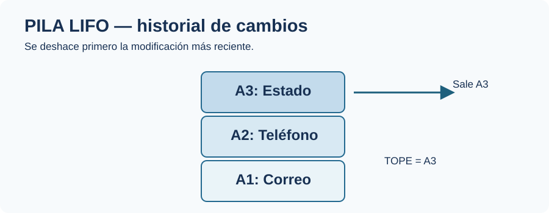
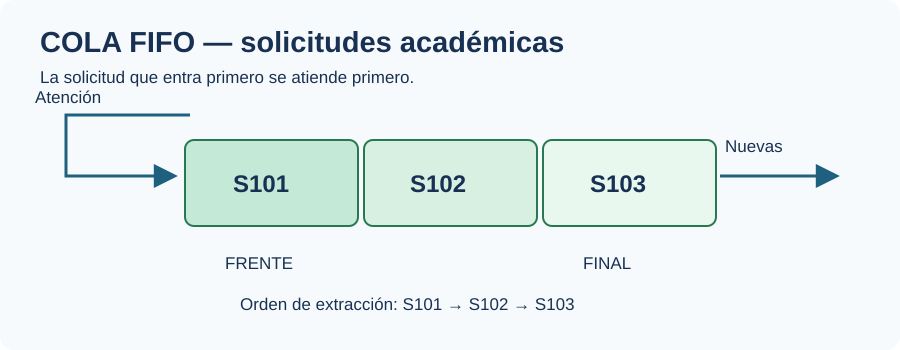
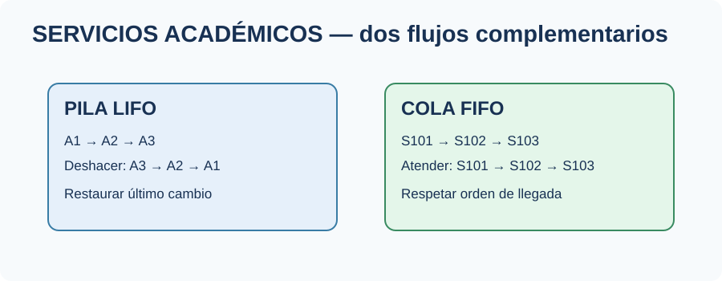

# PA3 — Pilas LIFO y colas FIFO
**Institución:** ISIL | **Carrera:** Desarrollo de Software | **Curso:** Algoritmo y Estructura de Datos Basados en Inteligencia Artificial | **Código:** 30710 | **NRC:** 4134  
**Docente:** Wildr Julio Espinoza Bravo | **Fecha:** 4 de noviembre de 2026

## Integrantes (mismo grupo de la PA2)
1. Leonardo Cuadros
2. Jhonatan Lino
3. Anthony Fernando
4. Victor Sinche

## Objetivo y caso
Una unidad de servicios académicos necesita deshacer modificaciones en orden inverso a su registro y atender solicitudes en el orden en que llegan. Se plantea una **pila LIFO** para deshacer, y una **cola FIFO** para los turnos.

## Actividad 1 — Pila LIFO
LIFO (*Last In, First Out*) significa último en entrar, primero en salir. Las operaciones sobre el único extremo (**tope**) son: `apilar`, `desapilar`, `ver_tope` y `esta_vacia`.

En la ficha académica se cambian correo (A1), teléfono (A2) y estado (A3). La pila almacena A1 → A2 → A3 (A3 arriba). Al deshacer se extraen A3, A2 y A1. Cada cambio guarda campo, valor anterior y valor nuevo, para restaurar realmente la ficha.



## Actividad 2 — Cola FIFO
FIFO (*First In, First Out*) significa primero en entrar, primero en salir. Se agrega por el **final** con `encolar` y se atiende por el **frente** con `desencolar`. Se incluyen `ver_frente` y `esta_vacia`.

Llegan tres solicitudes: S101 (constancia), S102 (orientación de matrícula), S103 (reclamo académico). En ese mismo orden se atienden: S101 → S102 → S103. No se aplica prioridad, porque el caso pide llegada estricta.



## Actividad 3 — Selección en situaciones reales

| Situación del enunciado | Estructura | Justificación técnica |
|---|---|---|
| Registro de acciones recientes para revertir cambios | **Pila** | La última operación debe deshacerse antes de las anteriores: LIFO. |
| Atención de solicitudes en orden de llegada | **Cola** | El primer registro debe atenderse primero: FIFO. |
| Procesamiento donde el último ingresado debe atenderse primero | **Pila** | Se retira primero el elemento ubicado en el tope. |
| Flujo de espera de trámites pendientes | **Cola** | Conserva la secuencia de llegada sin adelantar turnos. |

## Actividad 4 — Comparación académica

| Criterio | Pila | Cola |
|---|---|---|
| Principio | LIFO | FIFO |
| Acceso | Tope | Frente y final |
| Insertar | Apilar en el tope | Encolar al final |
| Retirar | Desapilar del tope | Desencolar del frente |
| Consultar sin quitar | Ver tope | Ver frente |
| Ventajas | Deshacer, retroceso, historial inverso | Turnos, atención ordenada, planificación FIFO |
| Costos con nodos y punteros | O(1) inserción/extracción/consulta | O(1) inserción/extracción/consulta |

Las estructuras son lineales, pero **no intercambiables**: cambiar una por la otra modifica qué elemento sale primero. Su recorrido completo cuesta O(n). Consultar el primer elemento no debe retirarlo. Cuando están vacías, extraer genera un error controlado.

## Algoritmos y diseño
El pseudocódigo incluye las ocho operaciones exigidas y el uso en el caso: [pseudocódigo](../pseudocodigo/algoritmos.md). La pila se implementa con un puntero al tope; la cola enlazada mantiene frente y final. Se validan estructuras vacías, solicitudes duplicadas y modificaciones sin cambios.



## Verificación reproducible
Ejecutar desde la carpeta `PA3_Pilas_Colas_30710`:

```bash
python -m app.demo
python -m unittest discover -s tests -v
```

Se verificaron **22 pruebas locales satisfactorias** de operaciones LIFO/FIFO, orden de llegada, casos vacíos, deshacer y validaciones.

## Conclusión grupal
La estructura correcta depende de la regla de atención. La pila protege la consistencia de los datos porque restaura primero el cambio más reciente; la cola mejora el orden y la previsibilidad de los trámites, respetando su llegada. Elegir bien evita inversiones de secuencia, reduce errores funcionales y ofrece operaciones eficientes O(1) en los extremos con nodos enlazados.

## Entrega y exposición
- Informe académico legible en GitHub: [desarrollo de las cuatro actividades](informe.md).
- Código Python: [app](../app/).
- Pruebas: [tests](../tests/test_pilas_colas.py).
- Guion para **cuatro** expositores: [guion](guion_exposicion_4.md).
- **Video en YouTube (no listado): PENDIENTE DE GRABAR Y PUBLICAR**. Pegar aquí la URL verdadera.
- **Asistencia y seguimiento**: se acreditan con el docente; no se declaran como realizados.

**Fuente base:** «PA3 - Evaluación aplicada sobre pilas y colas», sesiones 8 a 10, código 30710, enunciado y rúbrica entregados por el docente.
