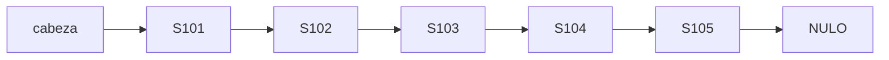
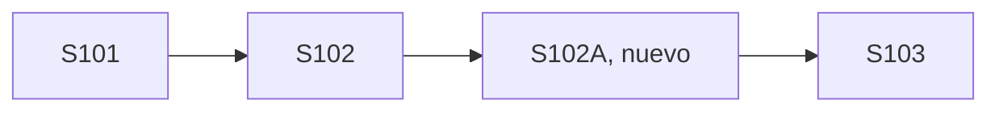
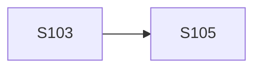
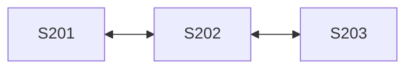
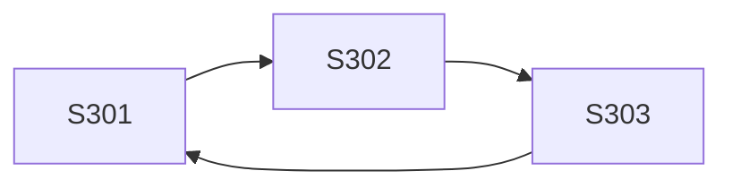

# Diagramas explicados

Los dibujos editables de Graphviz (`.svg`) y sus imágenes (`.png`) se encuentran en `diagramas/`.

## 1. Lista simple: cinco solicitudes

La cabeza referencia `S101`; cada nodo tiene un solo enlace `siguiente`; `S105` apunta a `NULO`.

## 2. Inserción después de S102

Antes de insertar: `S102.siguiente = S103`. Después: `S102.siguiente = S102A` y `S102A.siguiente = S103`. No se pierde el resto de la cadena.

## 3. Eliminación de S104

Antes: `S103 → S104 → S105`. Después: `S103 → S105`; el nodo `S104` deja de formar parte de la lista.

## 4. Lista doble

Cada nodo interior tiene `anterior` y `siguiente`. Es útil cuando el trabajador revisa un caso y necesita regresar al anterior sin recomenzar desde la cabeza.

## 5. Lista circular simple

El enlace del último nodo retorna a la cabeza: la ronda de revisión se puede repetir por ciclos. En código se controla el número de pasos para evitar recorridos infinitos.
